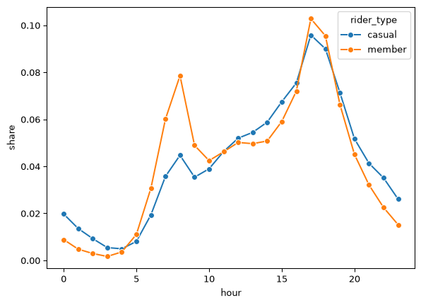
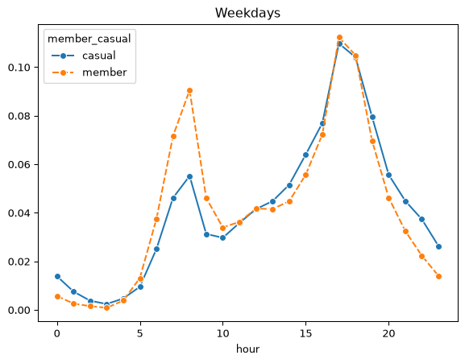
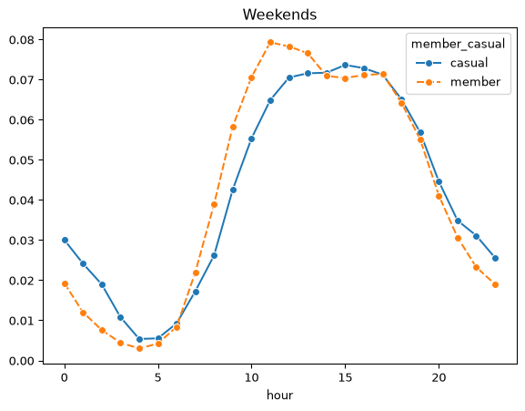
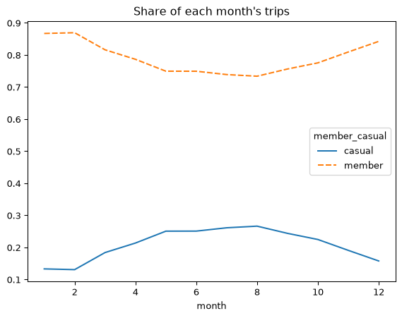
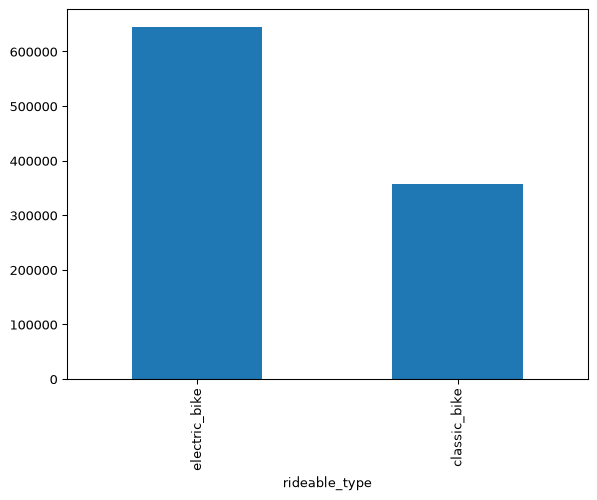
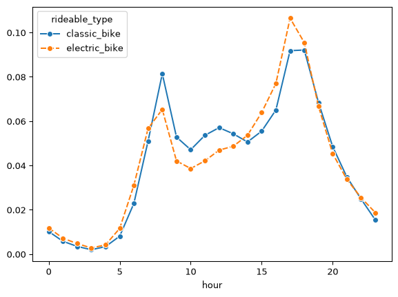
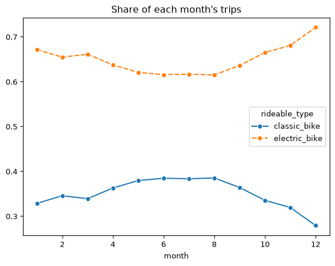
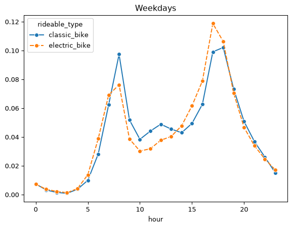
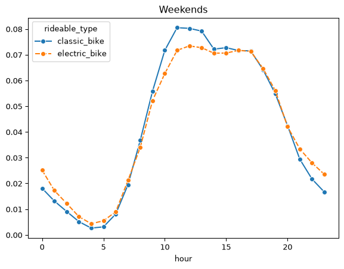
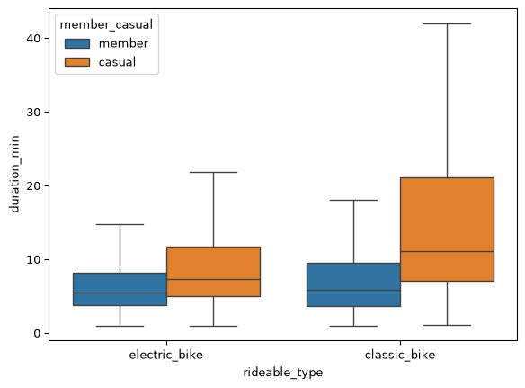

# New Jersey Citi Bikes


## Introduction

This project analyzes roughly one million trips from Citi Bike’s Jersey
City and Hoboken system in 2025 to ask how trip length differs between
member and casual riders, and between classic and electric bikes. The
twelve monthly files are combined and cleaned in Python (removing trips
under one minute or over 24 hours), then compared using grouped
summaries and a regression on log trip duration, with an interaction
between rider type and bike type. This lets the differences between the
four different rider and bike combinations be reflected as percentage
differences in typical trip length. \## Data

``` python
import pandas as pd 
import seaborn as sns
import matplotlib.pyplot as plt
import numpy as np
import statsmodels.formula.api as smf
```

``` python
bikeJan = pd.read_csv("/Users/jackghingo/Downloads/DataWrangling/Bikes/Jan3Bike.csv")
bikeFeb = pd.read_csv("/Users/jackghingo/Downloads/DataWrangling/Bikes/FebBike.csv")
bikeMar = pd.read_csv("/Users/jackghingo/Downloads/DataWrangling/Bikes/MarchBike.csv")
bikeApr = pd.read_csv("/Users/jackghingo/Downloads/DataWrangling/Bikes/AprilBike.csv")
bikeMay = pd.read_csv("/Users/jackghingo/Downloads/DataWrangling/Bikes/MayBike.csv")
bikeJune = pd.read_csv("/Users/jackghingo/Downloads/DataWrangling/Bikes/JuneBike.csv")
bikeJuly = pd.read_csv("/Users/jackghingo/Downloads/DataWrangling/Bikes/JulyBike.csv")
bikeAug = pd.read_csv("/Users/jackghingo/Downloads/DataWrangling/Bikes/AugBike.csv")
bikeSep = pd.read_csv("/Users/jackghingo/Downloads/DataWrangling/Bikes/SepBike.csv")
bikeOct = pd.read_csv("/Users/jackghingo/Downloads/DataWrangling/Bikes/OctBike.csv")
bikeNov = pd.read_csv("/Users/jackghingo/Downloads/DataWrangling/Bikes/NovBike.csv")
bikeDec = pd.read_csv("/Users/jackghingo/Downloads/DataWrangling/Bikes/DecBike.csv")
```

## CLEANING

``` python
months = [bikeJan, bikeFeb, bikeMar, bikeApr, bikeMay, bikeJune,
          bikeJuly, bikeAug, bikeSep, bikeOct, bikeNov, bikeDec]

bikes = pd.DataFrame()

for month_df in months:
    bikes = pd.concat([bikes, month_df], axis=0, ignore_index=True)
```

``` python
bikes["started_at"] = pd.to_datetime(bikes["started_at"])
bikes["ended_at"] = pd.to_datetime(bikes["ended_at"])

bikes["duration_min"] = (bikes["ended_at"] - bikes["started_at"]).dt.total_seconds() / 60

bikes = bikes.query(
    "duration_min >= 1 and duration_min <= 1440 "
    "and rideable_type in ['classic_bike', 'electric_bike']"
)
```

## Splitting

``` python
bikes["hour"] = bikes["started_at"].dt.hour
bikes["day_of_week"] = bikes["started_at"].dt.day_name()
bikes["is_weekend"] = bikes["started_at"].dt.dayofweek >= 5
bikes["month"] = bikes["started_at"].dt.month
bikes["date"] = bikes["started_at"].dt.normalize()

bikes[["started_at", "duration_min", "hour", "day_of_week", "is_weekend", "month", "date"]].head()

print(bikes.groupby("is_weekend")["duration_min"].mean())
print(bikes.groupby("day_of_week")["duration_min"].mean())

print(bikes["day_of_week"].value_counts())
```

    is_weekend
    False     8.810551
    True     11.786829
    Name: duration_min, dtype: float64
    day_of_week
    Friday        9.295259
    Monday        9.000053
    Saturday     11.313087
    Sunday       12.343849
    Thursday      8.726011
    Tuesday       8.566678
    Wednesday     8.454563
    Name: duration_min, dtype: float64
    day_of_week
    Friday       157671
    Thursday     151324
    Tuesday      148960
    Wednesday    148599
    Saturday     140889
    Monday       135065
    Sunday       119825
    Name: count, dtype: int64

## Member Assesment

``` python
bikes.groupby("member_casual").agg({"duration_min": ["mean", "median", "count"]})

bikes.groupby(["member_casual", "is_weekend"]).agg({"duration_min": ["mean", "median", "count"]})
```

<div>
<style scoped>
    .dataframe tbody tr th:only-of-type {
        vertical-align: middle;
    }
&#10;    .dataframe tbody tr th {
        vertical-align: top;
    }
&#10;    .dataframe thead tr th {
        text-align: left;
    }
&#10;    .dataframe thead tr:last-of-type th {
        text-align: right;
    }
</style>

<table class="dataframe" data-quarto-postprocess="true" data-border="1">
<thead>
<tr>
<th data-quarto-table-cell-role="th"></th>
<th data-quarto-table-cell-role="th"></th>
<th colspan="3" data-quarto-table-cell-role="th"
data-halign="left">duration_min</th>
</tr>
<tr>
<th data-quarto-table-cell-role="th"></th>
<th data-quarto-table-cell-role="th"></th>
<th data-quarto-table-cell-role="th">mean</th>
<th data-quarto-table-cell-role="th">median</th>
<th data-quarto-table-cell-role="th">count</th>
</tr>
<tr>
<th data-quarto-table-cell-role="th">member_casual</th>
<th data-quarto-table-cell-role="th">is_weekend</th>
<th data-quarto-table-cell-role="th"></th>
<th data-quarto-table-cell-role="th"></th>
<th data-quarto-table-cell-role="th"></th>
</tr>
</thead>
<tbody>
<tr>
<td rowspan="2" data-quarto-table-cell-role="th"
data-valign="top">casual</td>
<td data-quarto-table-cell-role="th">False</td>
<td>13.032411</td>
<td>7.498950</td>
<td>141960</td>
</tr>
<tr>
<td data-quarto-table-cell-role="th">True</td>
<td>17.524549</td>
<td>9.313783</td>
<td>80171</td>
</tr>
<tr>
<td rowspan="2" data-quarto-table-cell-role="th"
data-valign="top">member</td>
<td data-quarto-table-cell-role="th">False</td>
<td>7.811091</td>
<td>5.427350</td>
<td>599659</td>
</tr>
<tr>
<td data-quarto-table-cell-role="th">True</td>
<td>9.238966</td>
<td>6.096933</td>
<td>180543</td>
</tr>
</tbody>
</table>

</div>

These methods create seperate aggregate functions for riders that are
members and riders that are casuals. The first method just seperates the
two rider classes into mean, median, and count based on minutes. The
second does the same thing while factoring in whether or not it is the
weekend. On average casual members who don;t ride as often tend to have
signifigantly longer rides than memebers. However their total count is a
much smaller number. When casual members ride during the weekend their
average ride time increases signifigantly while members who ride during
the week tend to have the shortest average ride time.

``` python
hourly = bikes.pivot_table(
    index="hour",
    columns="member_casual",
    values="ride_id",
    aggfunc="count"
)

hourly_share = hourly / hourly.sum()

hourly_long = hourly_share.reset_index().melt(
    id_vars="hour", var_name="rider_type", value_name="share"
)

sns.lineplot(data=hourly_long, x="hour", y="share", hue="rider_type", marker="o")
plt.show()
```



The next difference amongst the types of riders I wanted to see is if
the hour of day hard a large effect on when riders paid for bikes. For
this method I created a pivot table in order to seperate members and
casuals by each hour of the day. The I melted the data to move each hour
in a single columns and the same with rider type. This allowed me to
graph the relationship between riders during each hour of the day.

Splitting up this information into weekdays and weekends

``` python
weekday = bikes.query("is_weekend == False")

weekday_hourly = weekday.pivot_table(
    index="hour",
    columns="member_casual",
    values="ride_id",
    aggfunc="count"
)

weekday_share = weekday_hourly / weekday_hourly.sum()

sns.lineplot(data=weekday_share, marker="o")
plt.title("Weekdays")
plt.show()
```



Whats interesting to see here is that they weekday graph looks very
similar to the overall graph previously displayed. It can be assumed
this is because the majority of the rides occur during the week. There
is a very clear spike in the morning and evening hours for members which
suggest they follow normal rush hour patterns. There is also a clear
difference in the morning rush between members and casuals that suggests
the weekdays experence more members riding during the morning rush than
the overall graph.

``` python
weekend = bikes.query("is_weekend == True")

weekend_hourly = weekend.pivot_table(
    index="hour",
    columns="member_casual",
    values="ride_id",
    aggfunc="count"
)

weekend_share = weekend_hourly / weekend_hourly.sum()

sns.lineplot(data=weekend_share, marker="o")
plt.title("Weekends")
plt.show()
```



The weekend graph suggest a compeltly different pattern than the
weekday. Instead of two seperate peaks there is just one singular
expansicve one over the course of the day. The mebers still have a
stronger peak but the patterns in this visual match each other a lot
more than the other two we have seen so far. This would suggest members
and casuals use the bikes for similar purposes over the weeekend.

Next I want to see if rider type changes not just during the day of the
week or hour but also the month of the year?

``` python
monthMix = bikes.groupby("month")["member_casual"].value_counts(normalize=True).unstack()
monthMix

sns.lineplot(data=monthMix)
plt.title("Share of each month's trips")
plt.show()
```



The share of each month’s trips vs the rider type shows a really
interesting relationship. During the summer months the members show a
decrease in their usage of the bikes potentially due to weather being
too hot to commute or the people taking their vacations during these
months. There is an inverse relationship with the casual riders however.
These types of riders are more frequent during the summer months
potentially because the weather is nicer and they can use the bikes
recreationally now.

Another feature of this data to consider when looking at rider behavior
is the time of bike they are using. There are two types of bikes
available to riders, classic and electric.

## Bike Type Assesment

``` python
bikes["rideable_type"].value_counts()

bikes["rideable_type"].value_counts().plot(kind="bar")
plt.show()
```



As we can see from this bar chart there is a much larger number of
electric bike rides than classic bike ones.

With electric bikes being the heavy favorite there could be reason to
believe that they have an association with the members rider type but
first another important aspect to look at could be when are riders using
these different bikes?

``` python
by_hour = bikes.pivot_table(index="hour", columns="rideable_type",
                            values="ride_id", aggfunc="count")

hourly2 = by_hour / by_hour.sum()

sns.lineplot(data=hourly2, marker="o")
plt.show()
```



The rush hour pattern is seen again comparing different kinds of bikes
over the course of the day but what makes this graph interesting is that
classic bikes see a larger proportion get used in the morning whereas
electric bikes see a surge when riders are on their way homes.

``` python
monthMix2 = bikes.groupby("month")["rideable_type"].value_counts(normalize=True).unstack()
monthMix

sns.lineplot(data=monthMix2, marker="o")
plt.title("Share of each month's trips")
plt.show()
```



Is this graph we see the same inverse pattern as early. Summer months
lead to more classic bike usage. When the weather gets colder this
pattern stops and the electric bike becomes the more popular.

Lets see how the different bikes behave on different days of the weeks
like the riders did.

``` python
weekday = bikes.query("is_weekend == False")

weekday_hourly2 = weekday.pivot_table(
    index="hour",
    columns="rideable_type",
    values="ride_id",
    aggfunc="count"
)

weekday_share2 = weekday_hourly2 / weekday_hourly2.sum()

sns.lineplot(data=weekday_share2, marker="o")
plt.title("Weekdays")
plt.show()
```



``` python
weekend = bikes.query("is_weekend == True")

weekend_hourly2 = weekend.pivot_table(
    index="hour",
    columns="rideable_type",
    values="ride_id",
    aggfunc="count"
)

weekend_share2 = weekend_hourly2 / weekend_hourly2.sum()

sns.lineplot(data=weekend_share2, marker="o")
plt.title("Weekends")
plt.show()
```



Both of these graphs are similar displays to the ones we have seen
earlier when looking at the difference between weekdays and weekends.
The different types of bikes rise at similar points when “member” and
“casual” also did. This suggests that there may be a relationship
between the type of riders and what bike they choose.

Lets look at some information involving all four of these groups.

## Rider Portfolios

``` python
bikes.groupby("member_casual")["rideable_type"].value_counts(normalize=True).unstack()
```

<div>
<style scoped>
    .dataframe tbody tr th:only-of-type {
        vertical-align: middle;
    }
&#10;    .dataframe tbody tr th {
        vertical-align: top;
    }
&#10;    .dataframe thead th {
        text-align: right;
    }
</style>

| rideable_type | classic_bike | electric_bike |
|---------------|--------------|---------------|
| member_casual |              |               |
| casual        | 0.269377     | 0.730623      |
| member        | 0.381490     | 0.618510      |

</div>

This shows us that both casual and member types use the electric a lot
more than they use the classic bike.

``` python
bikes.groupby("rideable_type")["duration_min"].agg(
    ["mean", "median", "std", "count"]
)

sns.boxplot(data=bikes, x="rideable_type", y="duration_min", hue="member_casual", showfliers=False)
plt.show()
```



Here we can see there is clearly a difference in behavior between the
duration of minutes when a rider is a casual rider on a classic bike.

``` python
bikes["log_duration"] = np.log(bikes["duration_min"])

bikes["group"] = (
    bikes["member_casual"].astype(str) + " " +
    bikes["rideable_type"].astype(str).str.replace("_bike", "")
)

groups = ["member electric", "member classic", "casual electric", "casual classic"]
```

``` python
typical = np.exp(bikes.groupby("group")["log_duration"].mean())
typical

# Step 2: pre-allocate an empty table, as in your iteration notes
comparison = pd.DataFrame(index=groups, columns=groups, dtype=float)

# Step 3: nested loop, fill in the percent difference for every pair
for row_group in groups:
    for col_group in groups:
        if row_group != col_group:
            comparison.loc[row_group, col_group] = (typical[row_group] / typical[col_group] - 1) * 100

pd.set_option("display.max_columns", None)
pd.set_option("display.width", 200)

comparison.round(1)
```

<div>
<style scoped>
    .dataframe tbody tr th:only-of-type {
        vertical-align: middle;
    }
&#10;    .dataframe tbody tr th {
        vertical-align: top;
    }
&#10;    .dataframe thead th {
        text-align: right;
    }
</style>

|  | member electric | member classic | casual electric | casual classic |
|----|----|----|----|----|
| member electric | NaN | -7.9 | -30.6 | -55.4 |
| member classic | 8.5 | NaN | -24.6 | -51.6 |
| casual electric | 44.0 | 32.7 | NaN | -35.8 |
| casual classic | 124.4 | 106.7 | 55.8 | NaN |

</div>

This chart is comparing the the baseline of each of the four groups
(columns) against a different group (rows) out of the four. So for
example the bottom left corner is 124.4. This means that trips for a
casual rider on a classic bike rides about 124.4% longer than a member
who is riding an electric(probably a daily commuter). This chart shows
the relationship between each of the 4 groups against each other.

Final takeaways from this Data -Classic Casual had the largest margin
compared to the other groups. -Member electric is the exact opposite as
they are lower than the baseline for every other group. -Rider type has
a much larger difference in the trip although bike type can have a large
difference in Casual riders.
